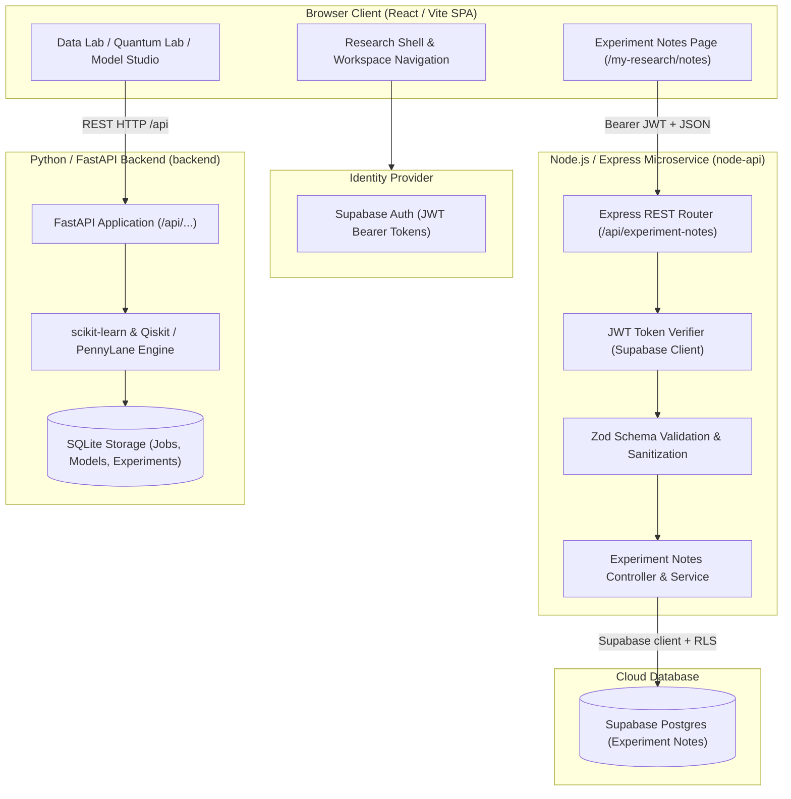

# EntangleX Q-Health

**A research-oriented hybrid quantum-classical machine-learning platform for evaluating biomedical disease-risk prediction and managing structured experiment notes.**

> [!IMPORTANT]
> **Research Prototype Disclaimer:** EntangleX Q-Health is designed for educational, research, and algorithmic evaluation purposes. Model predictions and risk estimates are based on benchmark and user-provided datasets; they do not constitute professional medical diagnosis, clinical prognosis, or treatment recommendations. The Experiment Notes feature provides qualitative research observation storage and is not an Electronic Health Record (EHR) or clinical record management system.

---

## 1. Overview and Problem Statement

### The Biomedical Machine Learning Challenge
Biomedical classification research demands reproducible data validation, leakage-safe preprocessing, isolated train/test evaluation, and traceable record-keeping. When evaluating classical algorithms alongside simulated quantum machine-learning models (such as Variational Quantum Classifiers and Quantum Neural Networks), researchers must systematically compare diagnostic accuracy, sensitivity, and calibration without unfounded presumptions of quantum advantage.

Furthermore, computational researchers require a dedicated, structured environment to document exploratory hypotheses, dataset anomalies, hyperparameter choices, and operational findings without mixing informal notes into formal prediction payloads or static PDF exports.

### The EntangleX Q-Health Solution
EntangleX Q-Health addresses these requirements through an integrated full-stack architecture:

1. **Interactive Research Interface:** A React-based single-page application providing responsive dataset visualization, data-quality auditing, feature selection, pipeline configuration, model training, comparison, and explainability.
2. **Specialized Machine-Learning Backend:** A Python FastAPI service responsible for executing scikit-learn pipelines, Qiskit/PennyLane quantum simulation, SHAP explainability, and SQLite-backed experiment tracking.
3. **Dedicated Experiment Notes Microservice:** An authenticated Node.js and Express REST API backed by the existing Supabase Postgres project, enabling researchers to create, search, update, and manage personal research notes with owner-level row security.

---

## 2. College Assignment Requirements

This project fulfills all requirements of the full-stack web development assignment by demonstrating modern frontend, backend, database, and DevOps practices:

| Assignment Requirement | Project Implementation & Source Mapping |
| :--- | :--- |
| **HTML5** | Semantic HTML structure, accessible forms, dialogue modals, and root template in [`frontend/index.html`](frontend/index.html). |
| **CSS3** | Modern responsive design, CSS custom properties, light/dark/research themes, accessible focus states, and flexbox/grid layouts in [`frontend/src/index.css`](frontend/src/index.css). |
| **JavaScript** | Native ES modules runtime in the Node.js API ([`node-api/src/`](node-api/src/)) and browser scripting; the frontend is authored in TypeScript ([`frontend/src/`](frontend/src/)), which compiles to standard JavaScript. |
| **React.js** | Interactive user interface built with React 19, functional components, custom hooks, context providers, and dynamic lazy-loaded routing in [`frontend/src/App.tsx`](frontend/src/App.tsx). |
| **Vite** | Modern frontend tooling, rapid hot-module reloading in development, and optimized production bundling configured in [`frontend/vite.config.ts`](frontend/vite.config.ts). |
| **Node.js** | Microservice runtime running on Node.js (version 22.x LTS pinned via [`.nvmrc`](.nvmrc)), executing the Experiment Notes backend. |
| **Express.js** | REST API framework handling HTTP routing, security headers (`helmet`), cross-origin policies (`cors`), input validation, and error management in [`node-api/src/app.js`](node-api/src/app.js). |
| **Supabase Postgres** | Persistent Experiment Notes storage with Postgres row-level security, indexes, and an updated-at trigger defined in [`supabase/migrations/20261017_create_experiment_notes.sql`](supabase/migrations/20261017_create_experiment_notes.sql). |
| **RESTful API Integration** | Typed asynchronous frontend client ([`frontend/src/lib/experimentNotesApi.ts`](frontend/src/lib/experimentNotesApi.ts)) executing standard HTTP methods against Express endpoints. |
| **Experiment Notes CRUD** | Complete Create, Read, Update, and Delete operations for user-scoped experiment notes with server-side validation, search filters, and database-enforced row-level security. |
| **Responsive UI Design** | Mobile-first and desktop-optimized layouts featuring collapsible sidebars, adaptive data grids, and responsive charts across all screen viewports. |
| **GitHub Source Code** | Managed in Git with branch isolation, automated test verification, and pull requests targeting [`Itzx-kush/web-dev-entangle`](https://github.com/Itzx-kush/web-dev-entangle). |
| **Vercel Deployment Readiness** | Shared frontend and Express service routing in [`vercel.json`](vercel.json); research API requests are proxied to the existing persistent FastAPI deployment. See [`docs/vercel-multi-service-deployment.md`](docs/vercel-multi-service-deployment.md) for routes and required environment variables. |
| **README Documentation** | Comprehensive project documentation covering problem formulation, architecture, technology stack, CRUD endpoints, setup, testing, and deployment. |

---

## 3. Technology Stack

The platform employs a multi-tier architecture uniting specialized services:

| Technology | Where It Is Used | Purpose & Responsibilities |
| :--- | :--- | :--- |
| **React 19** | Frontend (`frontend/src/`) | Declarative, component-driven UI for research workflows and experiment note management. |
| **TypeScript 5.9** | Frontend (`frontend/src/`) | Static typing, interface contracts, and compile-time safety across frontend modules. |
| **Vite 7** | Frontend (`frontend/`) | High-performance build tool, development server, and asset optimizer. |
| **React Query (@tanstack)** | Frontend (`frontend/src/`) | Asynchronous server-state management, automated cache invalidation, and optimistic mutations. |
| **Lucide React** | Frontend (`frontend/src/`) | Accessible, scalable SVG iconography across application navigation and data views. |
| **Node.js (>=20.x, 22.x LTS)** | Backend API (`node-api/`) | High-efficiency asynchronous JavaScript runtime for the Experiment Notes microservice. |
| **Express 4** | Backend API (`node-api/src/`) | Robust web framework providing RESTful routing, middleware pipelines, and HTTP controllers. |
| **Supabase Postgres + RLS** | Backend API (`node-api/src/db/supabase.js`) | Durable note persistence with authenticated-user policies and no service-role key in request handling. |
| **Zod 3** | Backend API (`node-api/src/validation/`) | Runtime type validation safeguarding API endpoints against malformed or injected payloads. |
| **Supabase Auth** | Frontend & Node API | User identity provider issuing JWT access tokens verified on protected API routes. |
| **Python 3.11** | Research Backend (`backend/`) | Execution engine for scientific computing, statistical analysis, and machine learning. |
| **FastAPI & Pydantic 2** | Research Backend (`backend/app/`) | High-performance Python REST APIs for dataset inspection, model training, and predictions. |
| **scikit-learn & NumPy** | Research Backend (`backend/app/ml/`) | Classical ML algorithms (Logistic Regression, SVM, Random Forest), PCA, and evaluation metrics. |
| **Qiskit & PennyLane** | Research Backend (`backend/app/quantum/`) | Quantum circuit synthesis, parameterized ansatz evaluation, and simulator execution. |
| **SQLite 3** | Research Backend (`backend/`) | Embedded storage for Python training jobs, model bundles, and experiment lineage. |
| **Vitest & Node Test Runner** | Testing (`frontend/`, `node-api/`) | Automated unit and integration test suites validating client and server contracts. |

---

## 4. Full-Stack System Architecture

The following diagram illustrates the decoupled separation of concerns across the client, services, and persistence layers:



### Architectural Division of Labor
- **Frontend Routing:** Client-side navigation is orchestrated by `react-router-dom`. Standard research workflows communicate with the Python backend via `/api/*` proxies. The Experiment Notes interface communicates directly with the Express REST API.
- **Node.js Express API (`node-api/`):** Manages qualitative research observations. It operates independently of the Python ML engine. All write operations enforce user authentication, input sanitization, and strict ownership isolation.
- **Python FastAPI Backend (`backend/`):** Dedicated entirely to heavy computational tasks: dataset normalization, ANOVA/PCA feature transforms, quantum simulator evaluation, and model artifact serialization.
- **Database Partitioning:** SQLite stores local training job queues and model artifact metadata. Supabase Postgres stores user-authored Experiment Notes with owner-scoped RLS.

---

## 5. Experiment Notes REST API & Supabase Postgres CRUD

The Experiment Notes microservice implements full CRUD capabilities through standard REST conventions:

| Operation | HTTP Method | Endpoint | Description | Auth Required |
| :--- | :--- | :--- | :--- | :--- |
| **Health Check** | `GET` | `/health` or `/api/health` | Returns service status, uptime, and Supabase table connectivity state. | No |
| **Create Note** | `POST` | `/api/experiment-notes` | Creates a new research note associated with the authenticated user. | Yes (Bearer JWT) |
| **List Notes** | `GET` | `/api/experiment-notes` | Retrieves a paginated list of notes owned by the caller with optional filters. | Yes (Bearer JWT) |
| **Get Single Note** | `GET` | `/api/experiment-notes/:id` | Retrieves a specific note by its UUID. | Yes (Bearer JWT) |
| **Update Note** | `PATCH` | `/api/experiment-notes/:id` | Partially updates mutable fields of an existing owned note. | Yes (Bearer JWT) |
| **Delete Note** | `DELETE` | `/api/experiment-notes/:id` | Permanently deletes a note owned by the authenticated caller. | Yes (Bearer JWT) |

### Data Model Schema (`ExperimentNote`)

Managed by Postgres and row-level security in [`supabase/migrations/20261017_create_experiment_notes.sql`](supabase/migrations/20261017_create_experiment_notes.sql):

| Field | Type | Required | Constraints & Description |
| :--- | :--- | :--- | :--- |
| `id` | String | Auto | Unique UUID generated by Postgres. |
| `title` | String | Yes | Trimmed, 1 to 200 characters. Descriptive summary of the note. |
| `content` | String | Yes | 1 to 10,000 characters. Detailed observations, parameters, or findings. |
| `datasetName` | String | No | Max 100 characters. Associated dataset (e.g., `Breast Cancer Wisconsin`, `Diabetes UCI`). |
| `modelName` | String | No | Max 100 characters. Associated model (e.g., `Random Forest`, `VQC`, `QNN`). |
| `experimentReference`| String | No | Max 100 characters. Identifier linking to a specific experiment snapshot. |
| `tags` | Array of Strings | No | Categorical tags (max 50 chars each) for indexing and filtering. |
| `ownerId` | String | System | Extracted from verified Supabase JWT; immutable; indexed for data isolation. |
| `createdAt` | Date | System | ISO 8601 creation timestamp managed by Postgres. |
| `updatedAt` | Date | System | ISO 8601 last-updated timestamp; indexed with `ownerId` for fast sorting. |

### Sample Request and Response

#### Creating a Note (`POST /api/experiment-notes`)

**Request Headers:**
```http
Authorization: Bearer <valid_supabase_access_token>
Content-Type: application/json
```

**Request Payload:**
```json
{
  "title": "VQC Angle Embedding Convergence",
  "content": "Observed 89.2% test accuracy when using 4 PCA components with ZZFeatureMap. Gradient variance decreased significantly after increasing sample budget to 160.",
  "datasetName": "Breast Cancer Wisconsin Diagnostic",
  "modelName": "VQC",
  "experimentReference": "exp-vqc-wdbc-01",
  "tags": ["quantum", "vqc", "pca", "wdbc"]
}
```

**Response (`201 Created`):**
```json
{
  "id": "67114dfa8b13d2459a123456",
  "title": "VQC Angle Embedding Convergence",
  "content": "Observed 89.2% test accuracy when using 4 PCA components with ZZFeatureMap. Gradient variance decreased significantly after increasing sample budget to 160.",
  "datasetName": "Breast Cancer Wisconsin Diagnostic",
  "modelName": "VQC",
  "experimentReference": "exp-vqc-wdbc-01",
  "tags": ["quantum", "vqc", "pca", "wdbc"],
  "ownerId": "usr-8a21f4bc-91e3-4d05-b16f",
  "createdAt": "2026-10-17T18:30:00.000Z",
  "updatedAt": "2026-10-17T18:30:00.000Z"
}
```

### Security & Cross-User Data Isolation
- **Ownership Scoping:** All database queries (`find`, `findOne`, `findOneAndUpdate`, `findOneAndDelete`) enforce `{ ownerId: req.user.id }`. Users cannot read, modify, or delete notes belonging to other researchers.
- **Payload Sanitization:** System fields (`ownerId`, `_id`, `id`, `createdAt`, `updatedAt`) cannot be provided or altered by client requests. Zod validation strips or rejects unauthorized keys before handlers execute.
- **CORS Protection:** In production, requests from unapproved origins are blocked with HTTP `403 Forbidden`. Wildcard origins (`*`) are strictly rejected when credentials are enabled.

---

## 6. Repository Structure

```
web-dev-entangle/
├── .env.example                 # Root configuration template for Python backend
├── .nvmrc                       # Pinned Node.js version (22.12.0)
├── NOTICE.md                    # Legal notices and third-party dataset attribution
├── SOURCE_MANIFEST.json         # Checksum manifest of baseline source files
├── render.yaml                  # Production deployment blueprint for Render
├── docs/                        # Technical specifications & deployment runbooks
│   ├── final-assignment-verification.md # Final full-stack verification report & evidence
│   ├── deployment-setup.md      # Production service routing and setup notes
│   ├── deployment.md            # Render & Docker architectural deployment specs
│   ├── api.md                   # Python FastAPI endpoint reference
│   ├── architecture.md          # In-depth system design & component diagrams
│   └── testing.md               # Test coverage and validation documentation
├── frontend/                    # React 19 + TypeScript Single-Page Application
│   ├── .env.example             # Frontend environment variables template
│   ├── .nvmrc                   # Pinned frontend Node.js version (22.12.0)
│   ├── package.json             # Frontend dependencies, scripts, and Vitest configuration
│   ├── vercel.json              # Vercel routing configuration for SPA deep-linking
│   ├── vite.config.ts           # Vite bundler configuration and dev proxy settings
│   └── src/
│       ├── App.tsx              # Application root, lazy route definitions, and providers
│       ├── components/          # Reusable UI components (ResearchShell, Navigation, etc.)
│       ├── lib/                 # API clients (experimentNotesApi.ts, api.ts)
│       ├── pages/               # Core view components (Overview, Datasets, Training, etc.)
│       ├── research/            # ExperimentNotesPage.tsx and research history views
│       └── tests/               # Vitest suite covering UI, state, and API clients
├── node-api/                    # Node.js + Express + Supabase-backed Notes API
│   ├── .env.example             # Express API environment variables template
│   ├── .nvmrc                   # Pinned API Node.js version (22.12.0)
│   ├── package.json             # Node microservice dependencies and test scripts
│   ├── vercel.json              # Vercel serverless function rewrites configuration
│   ├── api/
│   │   └── index.js             # Serverless handler export for Vercel deployment
│   ├── src/
│   │   ├── app.js               # Express app factory, CORS, helmet, and route wiring
│   │   ├── index.js             # Public service exports and default app instance
│   │   ├── local.js             # Local standalone development listener
│   │   ├── config/env.js        # Environment validation and parsing
│   │   ├── db/supabase.js       # User-scoped Supabase client and health probe
│   │   ├── validation/           # Request payload and UUID validation
│   │   ├── routes/              # Express routers (experimentNotes.routes.js, health)
│   │   └── middleware/          # JWT auth, centralized error handler, 404 handler
│   └── test/                    # Integration and deployment test suites
└── backend/                     # Python 3.11 FastAPI Research Backend
    ├── requirements.txt         # Pinned Python dependencies
    ├── app/                     # FastAPI routers, ML pipelines, and quantum modules
    └── tests/                   # Pytest test suite for ML and quantum workflows
```

---

## 7. Local Prerequisites & Step-by-Step Installation

### Prerequisites
- **Node.js:** `v22.12.0` (or `v20.x`+ LTS) and **npm** (`v10.x`+)
- **Python:** `CPython 3.11` (64-bit)
- **Supabase:** The existing Supabase project URL and public anon/publishable key, available to the Node API as `SUPABASE_URL` and `SUPABASE_ANON_KEY`.
- **Git:** Standard Git command-line client
- **Web Browser:** Any modern evergreen desktop browser (Chrome, Edge, Firefox, Safari)

---

### Step 1: Clone the Repository
```bash
git clone https://github.com/Itzx-kush/web-dev-entangle.git
cd web-dev-entangle
```

---

### Step 2: Configure Environment Files

Create local configuration files from the provided templates:

```powershell
# In project root
Copy-Item .env.example .env

# In node-api directory
Copy-Item node-api\.env.example node-api\.env

# In frontend directory
Copy-Item frontend\.env.example frontend\.env
```

*(On macOS/Linux, substitute `cp` for `Copy-Item`)*.

---

### Step 3: Set Up and Run the Node.js Express API

Open **Terminal 1**:
```bash
cd node-api
npm install
npm run dev
```
*The service will start on `http://localhost:5000` and use Supabase Postgres with the signed-in user's JWT for row-level-secured note access.*
- Verify health: `http://localhost:5000/health` (returns `{ "status": "ok", "database": "connected" }`).

---

### Step 4: Set Up and Run the React Frontend

Open **Terminal 2**:
```bash
cd frontend
npm ci
npm run dev
```
*The Vite development server will start on `http://localhost:5173`.*

---

### Step 5: (Optional) Set Up the Python Research Backend

If you wish to run classical and quantum ML training pipelines locally alongside the notes service, open **Terminal 3**:

```powershell
# Windows PowerShell
python -m venv .venv
.\.venv\Scripts\python.exe -m pip install --upgrade pip
.\.venv\Scripts\python.exe -m pip install -r backend\requirements.txt
.\.venv\Scripts\python.exe scripts\init_db.py
.\.venv\Scripts\python.exe -m uvicorn app.main:app --app-dir backend --host 127.0.0.1 --port 8000 --workers 1
```

*(For classical-only lightweight installation without Qiskit, install `backend/requirements-core.txt`)*.

---

### Step 6: Verify the Application in Your Browser

1. Open `http://localhost:5173` in your browser.
2. Sign in with your researcher credentials or activate guest access via the navigation menu.
3. Navigate to **Studio** → **Experiment notes** (`/my-research/notes`).
4. Click **Create New Note**, provide a title, content, and optional tags, and save.
5. Search, filter, update, and delete notes to verify full Supabase Postgres CRUD integration.

---

## 8. Environment Variables Specification

| Service | Variable Name | Purpose | Example / Default |
| :--- | :--- | :--- | :--- |
| **Frontend** | `VITE_API_BASE` | URL of the Python FastAPI backend | `/api` (local proxy) or `https://...onrender.com/api` |
| **Frontend** | `VITE_NODE_API_BASE` | URL of the Node.js Express Notes API | `http://localhost:5000/api` or `https://...vercel.app/api` |
| **Frontend** | `VITE_SUPABASE_URL` | Public Supabase project endpoint | `https://your-project.supabase.co` |
| **Frontend** | `VITE_SUPABASE_ANON_KEY` | Public Supabase anonymous client key | `eyJhbGciOi...` |
| **Node API** | `PORT` | Local HTTP listener port | `5000` |
| **Node API** | `NODE_ENV` | Application environment state | `development` or `production` |
| **Node API** | `SUPABASE_URL` | Supabase project URL | `https://your-project.supabase.co` |\n| **Node API** | `SUPABASE_ANON_KEY` | Public Supabase anon/publishable key | Set from Supabase project settings |
| **Node API** | `SUPABASE_URL` | Supabase endpoint for JWT verification | `https://your-project.supabase.co` |
| **Node API** | `SUPABASE_ANON_KEY` | Supabase client key for auth checks | `eyJhbGciOi...` |
| **Node API** | `CORS_ORIGINS` | Permitted frontend origins (comma-separated) | `http://localhost:5173,http://localhost:3000` |
| **Python** | `QHEALTH_STORAGE_ROOT` | Filesystem root for SQLite and artifacts | `.` |
| **Python** | `QHEALTH_CORS_ORIGINS` | Permitted origins for Python API | `http://localhost:5173` |

> [!WARNING]
> **Client-Side Security:** Variables prefixed with `VITE_*` are compiled directly into public browser bundles. Never place server secrets, service-role API keys, or database passwords in `frontend/.env`. Supabase's public anon key may be used by authenticated client/server requests under RLS; never place a service-role key in the browser or the notes API.

---

## 9. Deployment Architecture

The application is structured for cloud deployment:

```
┌────────────────────────────────┐         ┌────────────────────────────────┐
│   Vercel Project 1: Frontend   │         │   Vercel Project 2: Node API   │
│   • Root: frontend/            │         │   • Root: node-api/            │
│   • Framework: Vite Static SPA │         │   • Framework: Serverless      │
│   • Clean URLs & Deep Rewrites │         │   • api/index.js Express App   │
└────────────────┬───────────────┘         └────────────────┬───────────────┘
                 │                                          │
                 ▼                                          ▼
     ┌──────────────────────┐                   ┌──────────────────────┐
     │  Supabase Auth (JWT) │                   │ Supabase Postgres DB │
     └──────────────────────┘                   └──────────────────────┘
                 │
                 ▼
┌────────────────────────────────┐
│  Render Service: Python API    │
│  • Root: backend/ (render.yaml)│
│  • ML, Quantum, & Datasets     │
└────────────────────────────────┘
```

1. **Frontend Static SPA (Vercel Project 1):**
   - Root directory: `frontend/`
   - Build command: `npm run build` (outputs to `dist/`)
   - [`frontend/vercel.json`](frontend/vercel.json) rewrites all incoming routes (`/(.*)`) to `/index.html` to allow direct access and browser refreshes on deep paths like `/my-research/notes`.
2. **Node.js Express Serverless API (Vercel Project 2):**
   - Root directory: `node-api/`
   - Configured via [`node-api/vercel.json`](node-api/vercel.json) to route all requests to the serverless function export in [`node-api/api/index.js`](node-api/api/index.js).
   - Each notes request uses its verified user's JWT; Postgres RLS enforces ownership without a separate database connection string.
3. **Python FastAPI Backend (Render):**
   - Managed via [`render.yaml`](render.yaml) as an independent web service with persistent disk storage for model artifacts and training job state.
4. **Deployment Status:**
   - **Repository Deployment Readiness:** Complete. All configuration manifests, serverless handlers, CORS boundaries, and runbooks are committed.
   - **Live URLs:** Pending individual deployment linking by the repository maintainer. Refer to [`docs/deployment-setup.md`](docs/deployment-setup.md) for step-by-step instructions.

---

## 10. Automated Testing & Verification

The codebase maintains rigorous automated test suites across all tiers:

```bash
# 1. Run Node.js API test suite (44 tests covering CRUD, Auth, CORS, & Serverless)
cd node-api
npm test

# 2. Run React frontend test suite (33 test files, 177 unit & component tests)
cd ../frontend
npm test -- --run

# 3. Run frontend production build check
npm run build
```

### Verified Test Coverage Summary
- **Node.js API Tests (44 passed):**
  - Health check and database connection state reporting.
  - Authenticated note creation (`POST`), pagination and listing (`GET`), single fetch (`GET`), partial update (`PATCH`), and deletion (`DELETE`).
  - Strict input validation via Zod (rejection of empty titles, oversized content, and injected system fields).
  - Cross-user data isolation ensuring users cannot access or mutate records belonging to others.
  - Production CORS enforcement (permitting designated origins with credentials, returning 403 on unpermitted domains).
  - Cold-start database connection middleware and error handling.
- **Frontend Tests (177 passed):**
  - Typed API client URL resolution, query construction, Bearer token attachment, and transport error parsing.
  - Interactive research dashboard, dataset inspection, and pipeline controls.
  - Safe client-side routing, navigation state, and theme switching.
- **Production Build:**
  - Zero TypeScript compile errors (`tsc --noEmit`).
  - Vite static assets successfully compiled into `frontend/dist/`.

---

## 11. Scientific Limitations & Responsible Research Use

- **Diagnostic Boundary:** EntangleX Q-Health is an algorithmic research workbench. Predictions are probabilistic outputs generated from benchmark datasets (such as the UCI Breast Cancer Wisconsin Diagnostic and Early Stage Diabetes datasets). They are not medical diagnoses and must not be used for clinical decision-making.
- **Quantum Simulation:** Quantum machine learning models (VQC, QSVC, QNN) execute via local mathematical simulation on classical CPUs using Qiskit Aer and PennyLane. Simulation demonstrates circuit mechanics, parameter optimization, and ansatz representations; it does not demonstrate quantum supremacy or advantage over optimized classical baselines.
- **Dataset Provenance & Privacy:** Uploaded datasets are stored locally with UUID-derived filenames and SHA-256 integrity hashes. Raw records are never transmitted to external APIs or exposed publicly.

---

## 12. Documentation Index & Reference Links

- **Final Verification Report:** [`docs/final-assignment-verification.md`](docs/final-assignment-verification.md) — Comprehensive verification evidence, test results, and deployment readiness audit.
- **Deployment Runbook:** [`docs/deployment-setup.md`](docs/deployment-setup.md) — Guide for the shared Vercel deployment and Supabase-backed notes persistence.
- **Node API Specification:** [`node-api/README.md`](node-api/README.md) — Microservice architectural details, schema reference, and test scenarios.
- **Architecture Design:** [`docs/architecture.md`](docs/architecture.md) — In-depth architectural breakdown and component contracts.
- **Python Backend API Reference:** [`docs/api.md`](docs/api.md) — FastAPI endpoints for ML, datasets, and predictions.
- **Machine Learning Pipeline:** [`docs/ml_pipeline.md`](docs/ml_pipeline.md) — Preprocessing, ANOVA/MI feature selection, and CV fold evaluation boundaries.
- **Quantum Machine Learning:** [`docs/quantum_pipeline.md`](docs/quantum_pipeline.md) — Variational quantum circuits, quantum kernels, and ansatz configurations.
- **Testing Documentation:** [`docs/testing.md`](docs/testing.md) — Verification protocols and test harness specifications.
- **Security & Privacy:** [`docs/security.md`](docs/security.md) — Authentication, storage hardening, and privacy boundaries.
- **Dataset Provenance:** [`docs/data_provenance.md`](docs/data_provenance.md) — UCI benchmark citations and transformation records.
- **Legal Notices:** [`NOTICE.md`](NOTICE.md) — Attribution and third-party license notices.
